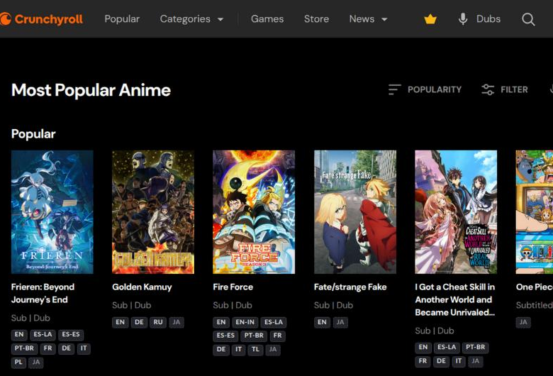
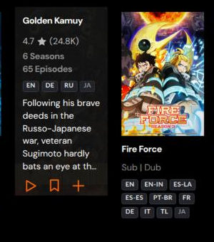
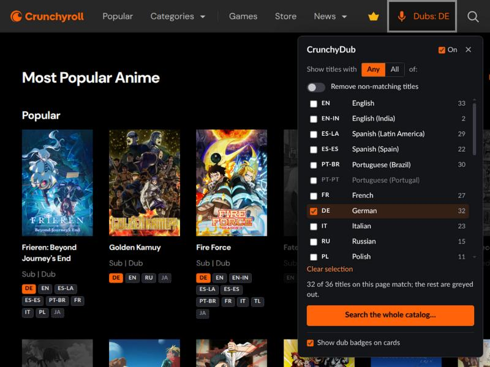
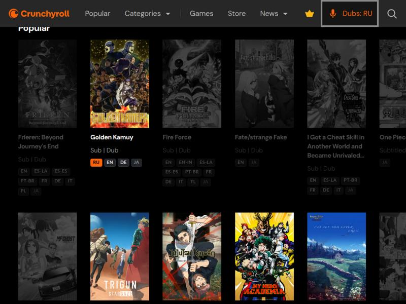
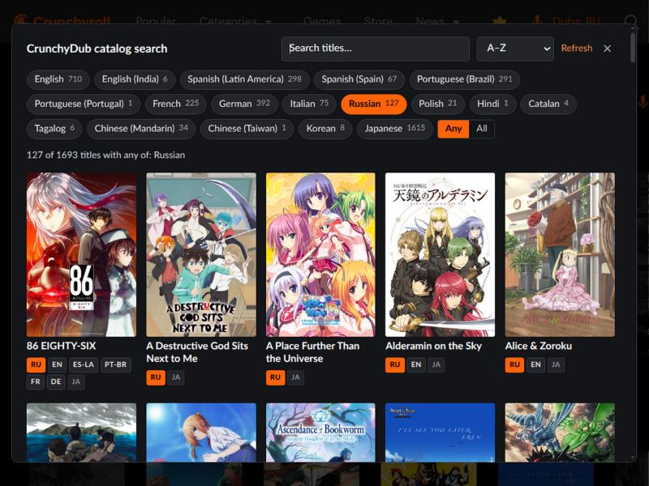

# CrunchyDub

A Firefox and Chrome extension that shows which dub languages every Crunchyroll series has, and lets you filter by them.

| Dub tags on every card | Also in the hover card |
| --- | --- |
|  |  |
| **Filter by language** | **Non-matching titles greyed out** |
|  |  |

## Features

- Dub tags on series cards, hover cards and the Discover banner
- Filter by one or more languages, matching any or all
- Non-matching titles are greyed out, or removed with one switch
- Search the whole catalog by dub language

## Privacy

No data is collected. CrunchyDub only talks to crunchyroll.com.

## Disclaimer

This project was written with AI assistance (Claude by Anthropic).

CrunchyDub is not affiliated with or endorsed by Crunchyroll.

## License

[GPL-3.0](LICENSE)
